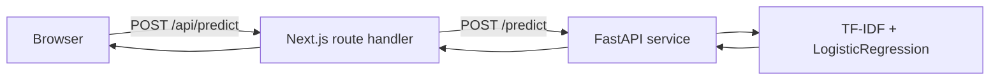

<div align="center">

# SMS Guardian

Spam message classifier with a confidence score and signal checks.

[](https://smsguardian.jsondu.space/)
[](https://nextjs.org/)
[](https://react.dev/)
[](https://fastapi.tiangolo.com/)
[](https://www.python.org/)
[](https://scikit-learn.org/)
[](https://docs.docker.com/compose/)

[Live app](https://smsguardian.jsondu.space/) · [What it does](#what-it-does) · [Quick start](#quick-start) · [Contributing](#contributing) · [Documentation](#documentation)

</div>

SMS Guardian is a web app that checks whether a text message looks like spam. A user pastes an SMS or chat message, and the app returns a `spam` or `ham` label, a confidence score, and a few visible signal checks. It is meant for a quick second opinion before replying, tapping a link, or sharing account details.

The app is aimed at everyday users who receive an unexpected or suspicious message. It is not a security operations tool and does not replace judgment about the sender.

> Message text is processed in memory. The app does not store it in a database or browser storage.

## Contents

- [What it does](#what-it-does)
- [How it works](#how-it-works)
- [Stack](#stack)
- [Repository structure](#repository-structure)
- [Using the app](#using-the-app)
- [Quick start](#quick-start)
- [Configuration](#configuration)
- [Checks](#checks)
- [Contributing](#contributing)
- [Model and data](#model-and-data)
- [Documentation](#documentation)
- [Privacy and limits](#privacy-and-limits)

## What it does

- Classifies a message as `spam` or `ham`.
- Returns the probability for the predicted label.
- Shows whether the message contains links, urgency wording, or prize and money wording. These are browser-side checks and do not change the model score.
- Treats confidence below 60% as borderline.
- Keeps message text in memory. The app does not write it to a database or browser storage.

## How it works



The browser never needs the backend address when the proxy route is used. The Next.js route handler reads `BACKEND_URL` on the server and forwards the request. FastAPI validates the text, runs the model, and returns the label, `is_spam`, and `confidence`.

For more detail, see [backend/README.md](backend/README.md) and [frontend/README.md](frontend/README.md).

## Stack

| Area | Stack |
| --- | --- |
| Frontend | Next.js 16.4.6, React 19.3.0, TypeScript 5, Tailwind CSS 4.3.5, PostCSS |
| Backend | Python 3.12, FastAPI, Uvicorn, Pydantic, scikit-learn 1.6.1, joblib |
| Tooling | Docker Compose, GitHub Actions, Vercel, Husky, ESLint, flake8 |

## Repository structure

```text
.
├── backend/                  FastAPI service and runtime model
│   ├── README.md             API, Docker, CI/CD, security notes
│   ├── main.py               Application and prediction endpoint
│   ├── message_classifier.joblib
│   ├── requirements.txt
│   └── Dockerfile
├── frontend/                 Next.js App Router app
│   ├── README.md             UI, proxy routes, Docker, CI/CD
│   ├── app/                  Pages, components, and route handlers
│   ├── package.json
│   └── Dockerfile
├── .github/
│   ├── workflows/            CI checks and container publishing
│   └── PULL_REQUEST_TEMPLATE.md
├── scripts/                  Commit message check
├── sms-message-classifier.ipynb
├── message_classifier.joblib
├── docker-compose.yml
├── vercel.json
├── AGENTS.md
├── DESIGN.md
└── PRODUCT.md
```

## Using the app

1. Start the services with Docker or the local commands below.
2. Open http://localhost:3000.
3. Paste a message into the textarea, or select one of the preset examples.
4. Press `Check message` or use Ctrl+Enter. On macOS, use Cmd+Enter.
5. Read the verdict, confidence, and signal checks. If confidence is below 60%, the result is shown as borderline.
6. Use `Copy report` to copy a short summary.

> The link, urgency, and prize checks are simple pattern matches. Treat them as hints, not as part of the model prediction.

## Quick start

### Docker

From the repository root:

```bash
docker compose up --build
```

| Service | URL |
| --- | --- |
| Frontend | http://localhost:3000 |
| API | http://localhost:8000 |

Stop the services with `docker compose down`.

To apply code changes without stopping the stack, run Compose Watch:

```bash
docker compose up --watch
```

Backend source changes sync and restart the container. Changes to `backend/requirements.txt`, `backend/Dockerfile`, or anything under `frontend/` rebuild the affected image. The frontend image runs the compiled Next.js build, so frontend edits still take a rebuild rather than hot reload.

The frontend container gets `BACKEND_URL=http://backend:8000` from Compose. The backend allows requests from `http://localhost:3000` and `http://127.0.0.1:3000` by default.

### Local development

You need Python 3.12, Node 22, and npm.

**Backend**

```powershell
python -m venv .venv
.venv\Scripts\Activate.ps1
pip install -r backend/requirements.txt
uvicorn main:app --app-dir backend --reload --port 8000
```

On macOS or Linux, use `source .venv/bin/activate`.

**Frontend**

```bash
cd frontend
npm install
npm run dev
```

Open http://localhost:3000.

The root `package.json` only contains repository tooling for Husky and lint-staged. Run `npm install` at the root if you want the commit hooks. It does not install the frontend dependencies.

## Configuration

| Variable | Used by | Default | Purpose |
| --- | --- | --- | --- |
| `BACKEND_URL` | Frontend server | `http://localhost:8000` | Target for the `/api/predict` and `/api/health` route handlers. |
| `NEXT_PUBLIC_API_URL` | Frontend build | unset | When set, the browser calls the backend directly instead of using the proxy. |
| `ALLOWED_ORIGINS` | Backend | `http://localhost:3000,http://127.0.0.1:3000` | Comma-separated CORS origins. |

> `NEXT_PUBLIC_API_URL` is embedded in the client bundle. Never put a secret in it. For direct browser calls, add the frontend origin to `ALLOWED_ORIGINS`.

## Checks

Install the backend dev requirements and frontend dependencies first:

```bash
pip install -r backend/requirements-dev.txt
npm --prefix frontend install
```

Run from the repository root:

```bash
npm run lint
npm run typecheck:frontend
npm run build:frontend
```

`npm run lint` runs ESLint on the frontend and flake8 on the backend. CI also runs the type check and production build, loads the model, and sends two sample messages to a running API instance.

## Contributing

### Workflow

1. Create a branch from `main`.
2. Make the change and update the relevant README files.
3. Run the checks in the previous section.
4. Commit with a message that follows the format below.
5. Open a pull request and complete the template.

### Branch naming

Create a branch with a type prefix and a short description:

```text
<type>/<short-description>
```

Use lowercase words separated by hyphens. Keep the description short and specific.

| Type | Use for | Example |
| --- | --- | --- |
| `feat` | New behavior or UI | `feat/frontend-confidence-warning` |
| `fix` | Bug fixes | `fix/backend-empty-text` |
| `docs` | Documentation | `docs/update-api-examples` |
| `style` | Formatting or visual changes with no behavior change | `style/adjust-scanner-spacing` |
| `refactor` | Code changes that do not add behavior | `refactor/split-prediction-route` |
| `perf` | Performance improvements | `perf/cache-model-load` |
| `test` | Tests | `test/cover-empty-messages` |
| `build` | Build or dependency changes | `build/update-node-version` |
| `ci` | Workflow changes | `ci/add-frontend-typecheck` |
| `chore` | Maintenance | `chore/update-dependencies` |
| `revert` | Reverting a change | `revert/scanner-layout` |

### Commit messages

Commit messages must follow:

```text
<type>: <message>
```

Use the same types as branch names. The Husky hook runs `scripts/check-commit-msg.js` and rejects messages that do not match.

```text
fix: handle whitespace-only messages
feat: show borderline confidence warning
docs: add backend Docker notes
```

Use exactly `<type>: <message>`. Do not wrap the type in brackets or use more than one space after the colon. Keep the first line short.

### Pull requests

- Keep a pull request focused on one area. Split unrelated backend and frontend changes when they can be reviewed separately.
- Complete `.github/PULL_REQUEST_TEMPLATE.md`.
- Describe how you tested the change and list the commands you ran.
- Add screenshots or a short recording for UI changes.
- Update the README files when endpoints, environment variables, commands, or model behavior change.
- Update `backend/README.md` or `frontend/README.md` when architecture, Docker, or CI/CD changes.
- Do not commit secrets, credentials, private message data, or `.env` files.

### Model changes

If you retrain the model:

1. Update `sms-message-classifier.ipynb`.
2. Record the test metrics in the pull request and in this README.
3. Rename the notebook output from `spam_classifier.joblib` to `message_classifier.joblib`.
4. Replace both `message_classifier.joblib` copies.
5. Restart the backend or rebuild the Docker image.

### Security

- The app must not log or persist message text.
- Do not add secrets to the repository, Docker images, or environment files.
- Keep CORS origins explicit. Do not use `*` with credentials.
- Treat `NEXT_PUBLIC_*` values as public.
- Report sensitive security problems through GitHub private vulnerability reporting if it is enabled, not in a public issue.

## Model and data

The model is a scikit-learn pipeline:

```python
TfidfVectorizer(stop_words="english", max_features=5000)
LogisticRegression(class_weight="balanced", max_iter=1000)
```

Training data combines ham messages from the UCI SMS Spam Collection with spam messages from the Philippine spam SMS dataset:

| Source | Rows used | Label |
| --- | --- | --- |
| [UCI SMS Spam Collection](https://www.kaggle.com/datasets/uciml/sms-spam-collection-dataset), `spam.csv` | 4,825 | `ham` only |
| [Philippine spam SMS messages](https://www.kaggle.com/datasets/bwandowando/philippine-spam-sms-messages), `SPAM_SMS.csv` | 1,023 | `spam` only |

After cleaning, the combined set has 5,848 messages. The 80/20 stratified split uses `random_state=42` and produces 4,678 training rows and 1,170 test rows.

| Metric | Result |
| --- | --- |
| Accuracy | 0.99 |
| Ham F1 | 1.00 |
| Spam F1 | 0.99 |

The dataset is not balanced and each source contributes one class. The model can learn source and language cues as well as spam cues. Treat the 0.99 score as a result on this mixed split, not as a measure of live SMS performance.

The notebook writes `spam_classifier.joblib`. The runtime expects `message_classifier.joblib`. Keep the root and backend copies identical.

## Documentation

| Document | What it covers |
| --- | --- |
| [Backend README](backend/README.md) | API, model loading, Docker, CI/CD, and backend security notes. |
| [Frontend README](frontend/README.md) | UI structure, proxy routes, Docker, CI/CD, and frontend security notes. |
| [AGENTS.md](AGENTS.md) | Repository conventions for coding agents. |
| [DESIGN.md](DESIGN.md) | Colors, typography, components, and layout rules. |
| [PRODUCT.md](PRODUCT.md) | Product scope and user context. |

## Privacy and limits

The app does not store message text in a database, browser storage, or cookies. The FastAPI service processes each message in memory. Hosting providers and reverse proxies may still keep request metadata, so review their logging settings before deploying.

- The model is a demo-sized classifier, not a production security product.
- Confidence is not calibrated against real messages.
- The browser signal checks are regular expressions, not model output.
- The dataset mix limits how well the test score generalizes.

---

<p align="center"><a href="#sms-guardian">Back to top</a></p>
