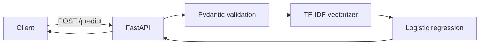

<div align="center">

# Backend

FastAPI service for SMS Guardian.

[](https://www.python.org/)
[](https://fastapi.tiangolo.com/)
[](https://scikit-learn.org/)
[](https://www.docker.com/)

[Architecture](#architecture) · [Endpoints](#endpoints) · [Docker](#docker) · [CI/CD](#cicd)

</div>

The backend is a FastAPI service that classifies a text message with a scikit-learn pipeline. It exposes `/health` and `/predict` and returns JSON. The service is stateless and keeps the model in memory.

## Contents

- [At a glance](#at-a-glance)
- [Architecture](#architecture)
- [Endpoints](#endpoints)
- [Configuration](#configuration)
- [Local development](#local-development)
- [Dependencies](#dependencies)
- [Docker](#docker)
- [CI/CD](#cicd)
- [Model and data](#model-and-data)
- [Troubleshooting](#troubleshooting)
- [Contributing](#contributing)
- [Security notes](#security-notes)

## At a glance

| Property | Value |
| --- | --- |
| Framework | FastAPI |
| Runtime | Python 3.12 |
| Model | TF-IDF + LogisticRegression |
| State | Stateless |
| Storage | None |
| Default port | 8000 |

## Architecture



`main.py` creates the FastAPI app, configures CORS, and loads the model from `message_classifier.joblib` next to the module. With `uvicorn main:app --app-dir backend`, the path is `backend/message_classifier.joblib`.

The model is loaded once at startup. If the artifact is missing or was saved with an incompatible scikit-learn version, the process exits instead of serving requests.

`predict` strips the input, rejects whitespace-only text with 400, and calls `model.predict`. When the model supports `predict_proba`, it returns the probability for the predicted class. Confidence is rounded to four decimal places.

The service has no database, queue, cache, or background worker. Each request is validated, classified, and returned.

## Endpoints

| Method | Path | Purpose |
| --- | --- | --- |
| `GET` | `/health` | Liveness check. Returns `{"status": "ok"}`. |
| `POST` | `/predict` | Classifies a message. |

### `POST /predict`

Request:

```json
{"text": "Congratulations! You won a free prize, claim now"}
```

Response:

```json
{"label": "spam", "is_spam": true, "confidence": 0.98}
```

| Field | Meaning |
| --- | --- |
| `label` | `spam` or `ham`. |
| `is_spam` | True when `label` is `spam`. |
| `confidence` | Probability of the predicted label. |

`text` must be between 1 and 5,000 characters. Whitespace-only text returns 400. A body that fails validation returns 422. The API docs are available at `/docs` and `/redoc` by default.

## Configuration

| Variable | Required | Default | Purpose |
| --- | --- | --- | --- |
| `ALLOWED_ORIGINS` | No | `http://localhost:3000,http://127.0.0.1:3000` | Comma-separated origins for CORS. |

> Set exact origins in production. The middleware uses credentials, so do not use `*` as an origin. If the browser calls the backend directly through `NEXT_PUBLIC_API_URL`, add the frontend origin to this list.

The service does not need API keys, database credentials, or other secrets.

## Local development

Requirements: Python 3.12. From the repository root:

```powershell
python -m venv .venv
.venv\Scripts\Activate.ps1
pip install -r backend/requirements.txt
uvicorn main:app --app-dir backend --reload --port 8000
```

On macOS or Linux, activate the environment with `source .venv/bin/activate`.

Test the service:

```powershell
Invoke-RestMethod -Method Get -Uri http://localhost:8000/health
Invoke-RestMethod -Method Post -Uri http://localhost:8000/predict `
  -ContentType 'application/json' `
  -Body '{"text":"Congratulations! You won a free prize, claim now"}'
```

Restart the service after replacing the model file.

## Dependencies

| Package | Role |
| --- | --- |
| `fastapi` | HTTP API and request validation integration. |
| `uvicorn[standard]` | ASGI server. |
| `scikit-learn==1.6.1` | Model pipeline. |
| `joblib` | Loads the serialized model. |
| `pydantic` | Request and response models. |
| `flake8` | Lint check in development. Installed from `requirements-dev.txt`. |

> The scikit-learn version is pinned because joblib artifacts are not guaranteed to load across versions. Retrain the model if you upgrade scikit-learn.

## Docker

The build context is the repository root because the image includes the root model artifact and the `backend` directory.

```bash
docker build -f backend/Dockerfile -t sms-guardian-backend .
docker run --rm -p 8000:8000 -e ALLOWED_ORIGINS=http://localhost:3000 sms-guardian-backend
```

The image uses `python:3.12-slim`, installs `backend/requirements.txt`, copies the model and application code, and runs:

```text
uvicorn backend.main:app --host 0.0.0.0 --port 8000
```

| Detail | Value |
| --- | --- |
| Base image | `python:3.12-slim` |
| Working directory | `/app` |
| Exposed port | `8000` |
| Runtime config | `ALLOWED_ORIGINS` |
| Model path | `/app/backend/message_classifier.joblib` |

Compose starts the backend with the frontend:

```bash
docker compose up --build
```

To apply backend changes without stopping the stack, use Compose Watch:

```bash
docker compose up --watch
```

The watch rules sync changes under `backend/` into `/app/backend` and restart the container, so Uvicorn loads the new code. Changes to `backend/requirements.txt` or `backend/Dockerfile` rebuild the image instead. The model is loaded at startup, so replacing `backend/message_classifier.joblib` also requires the container restart that Watch performs.

The Compose service sets `ALLOWED_ORIGINS` for local frontend access. The build context excludes `.env` files, notebooks, caches, and `.git` through `.dockerignore`.

> The Dockerfile runs Uvicorn as the default container user. Add a non-root user if your deployment policy requires one.

## CI/CD

| Workflow | Trigger | What it does |
| --- | --- | --- |
| CI | Push to `main`, pull request, manual dispatch | Lint, model load check, API smoke test |
| CD | Push to `main`, tag `v*`, manual dispatch | Build and push the backend image to GHCR |

### CI

`.github/workflows/ci.yml` runs the backend job:

1. Installs Python 3.12 and the dev requirements.
2. Runs `python -m flake8 backend`.
3. Loads `message_classifier.joblib` with joblib to verify the artifact.
4. Starts Uvicorn, calls `/health`, and posts two sample messages to `/predict`.

The smoke test checks that the service starts and returns successful HTTP responses. It does not assert the predicted labels. The workflow has `contents: read` permission.

### CD

`.github/workflows/cd.yml` runs the backend image job:

1. Builds the image from `backend/Dockerfile` with the repository root as context.
2. Logs in to GHCR with the workflow `GITHUB_TOKEN`.
3. Pushes `ghcr.io/<owner>/<repo>-backend` with branch, semver, commit SHA, and `latest` tags when applicable.
4. Uses GitHub Actions cache for Docker layers.

The workflow permissions are limited to `contents: read` and `packages: write`. No registry password is stored in the repository.

`vercel.json` defines a backend service with the FastAPI framework. Vercel deployment configuration is separate from the container publishing workflow.

## Model and data

The runtime artifact is `backend/message_classifier.joblib`. The root `message_classifier.joblib` is also copied into the image and should stay identical. The service loads the backend copy. The training notebook is `sms-message-classifier.ipynb` at the repository root.

```python
TfidfVectorizer(stop_words="english", max_features=5000)
LogisticRegression(class_weight="balanced", max_iter=1000)
```

Training data comes from two Kaggle datasets: ham rows from the UCI SMS Spam Collection and spam rows from the Philippine spam SMS dataset.

| Source | Rows used | Label |
| --- | --- | --- |
| UCI SMS Spam Collection | 4,825 | `ham` only |
| Philippine spam SMS messages | 1,023 | `spam` only |

The combined set has 5,848 messages after cleaning. The 80/20 stratified split produces 4,678 training rows and 1,170 test rows.

| Metric | Result |
| --- | --- |
| Accuracy | 0.99 |
| Ham F1 | 1.00 |
| Spam F1 | 0.99 |

To retrain, run the notebook, rename the output from `spam_classifier.joblib` to `message_classifier.joblib`, and replace both model copies. Restart the service or rebuild the image afterward.

## Troubleshooting

| Symptom | What to check |
| --- | --- |
| `502` from the frontend | `BACKEND_URL` and whether the backend process is running. |
| CORS error in the browser | The frontend origin is listed in `ALLOWED_ORIGINS`. |
| Model load error at startup | The artifact path and the installed scikit-learn version. |
| `400` from `/predict` | The message is empty or whitespace-only. |
| `422` from `/predict` | The body does not match the schema or the text is over 5,000 characters. |

## Contributing

See the [root README](../README.md#contributing) for branch naming, commit format, and pull request steps.

## Security notes

- The application does not log or persist message text. Uvicorn access logs record method, path, and status, not the request body. Hosting and proxy logs may keep metadata.
- Keep `ALLOWED_ORIGINS` limited to the origins that need access.
- Do not add secrets to the image, environment files, or repository. The service does not require any.
- FastAPI serves `/docs` and `/redoc` by default. Disable them in production if the schema should not be public.
- Run the service behind TLS at the platform edge or a reverse proxy.
- Keep scikit-learn pinned and rebuild the image after a model or dependency change.

---

<p align="center"><a href="#backend">Back to top</a></p>
