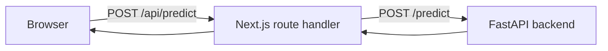

<div align="center">

# Frontend

Next.js App Router interface for SMS Guardian.

[](https://nextjs.org/)
[](https://react.dev/)
[](https://www.typescriptlang.org/)
[](https://tailwindcss.com/)
[](https://www.docker.com/)

[Architecture](#architecture) · [Local development](#local-development) · [Docker](#docker) · [CI/CD](#cicd)

</div>

The frontend is a Next.js 16 App Router app for SMS Guardian. It renders the scanner, sends message text to the FastAPI backend, and displays the verdict, confidence, and browser-side signal checks.

## Contents

- [At a glance](#at-a-glance)
- [Architecture](#architecture)
- [Configuration](#configuration)
- [Local development](#local-development)
- [Dependencies](#dependencies)
- [Docker](#docker)
- [CI/CD](#cicd)
- [Troubleshooting](#troubleshooting)
- [Contributing](#contributing)
- [Security notes](#security-notes)

## At a glance

| Property | Value |
| --- | --- |
| Framework | Next.js 16.4.6 App Router |
| UI runtime | React 19.3.0 |
| Language | TypeScript 5 |
| Styling | Tailwind CSS 4.3.5 |
| Default port | 3000 |
| Backend access | Server-side route handler or direct public URL |

## Architecture



- `app/page.tsx` is a client component. It holds the message text, loading state, error state, and prediction result. It posts to `/api/predict` by default.
- `app/api/predict/route.ts` forwards the request to `BACKEND_URL` and passes backend errors through.
- `app/api/health/route.ts` forwards `GET /health` to the backend.
- If `NEXT_PUBLIC_API_URL` is set at build time, the browser posts directly to `${NEXT_PUBLIC_API_URL}/predict` instead of using the proxy.

### Components

| File | Role |
| --- | --- |
| `app/page.tsx` | Page state, scan request, splash timing, section layout. |
| `app/components/scanner-form.tsx` | Textarea, character counter, presets, submit and clear controls. |
| `app/components/verdict-section.tsx` | Loading, error, empty, and result states. |
| `app/components/result-card.tsx` | Verdict, confidence meter, regex signal checks, copy report. |
| `app/components/hero-section.tsx` | Hero copy and radar placement. |
| `app/components/tactical-radar.tsx` | Canvas radar demo and sample selection. |
| `app/components/threat-signals.tsx` | Static cards explaining link, urgency, and bait patterns. |
| `app/components/splash.tsx` | Animated loading screen with reduced-motion handling. |
| `app/components/site-header.tsx` | Sticky header and scan link. |
| `app/components/site-footer.tsx` | Footer and endpoint list. |
| `app/components/icons.tsx` | Inline SVG icons. |

### Styling and motion

- Tailwind CSS v4 is loaded through `@tailwindcss/postcss` and imported in `app/globals.css`.
- Design tokens for color, type, and easing live in the `@theme` block in `app/globals.css`.
- Bricolage Grotesque, IBM Plex Sans, and JetBrains Mono are loaded with `next/font/google` and self-hosted at build time.
- Animations are defined in CSS and use `motion-safe` variants or the `prefers-reduced-motion` media query.
- The design system is documented in `../DESIGN.md`.

### Data handling

- Message text stays in React state while the page is open.
- The app does not use `localStorage`, `sessionStorage`, or cookies for message text.
- The result card runs regex checks for links, urgency words, and prize or money wording. These checks only affect the display.
- When the proxy route is used, `BACKEND_URL` stays on the server and is not included in the client bundle.

## Configuration

| Variable | Set at | Default | Purpose |
| --- | --- | --- | --- |
| `BACKEND_URL` | Runtime, server | `http://localhost:8000` | Target for `/api/predict` and `/api/health`. |
| `NEXT_PUBLIC_API_URL` | Build time, public | unset | When set, the browser calls the backend directly. |

> `NEXT_PUBLIC_*` values are embedded in the client bundle. Never put a secret in one. Direct browser calls require the frontend origin in the backend `ALLOWED_ORIGINS`.

## Local development

Requirements: Node 22 and npm. Start the backend on port 8000 first.

```bash
cd frontend
npm install
npm run dev
```

Open http://localhost:3000. The proxy uses `BACKEND_URL`, which defaults to `http://localhost:8000`.

| Script | Purpose |
| --- | --- |
| `npm run dev` | Start the development server. |
| `npm run build` | Create a production build. |
| `npm run start` | Serve the production build. |
| `npm run lint` | Run ESLint. |
| `npm run typecheck` | Run the TypeScript check. |

This Next.js version has breaking changes. Read `AGENTS.md` in this directory and the guides under `node_modules/next/dist/docs/` before changing routing or rendering behavior.

## Dependencies

| Package | Role |
| --- | --- |
| `next` 16.4.6 | App Router, route handlers, build pipeline. |
| `react` 19.3.0, `react-dom` 19.3.0 | UI runtime. |
| `tailwindcss` 4.3.5 | Styling. |
| `@tailwindcss/postcss`, `postcss` | Tailwind build integration. |
| `typescript` 5 | Type checking. |
| `eslint` 9, `eslint-config-next` | Lint checks. |
| `@types/node`, `@types/react`, `@types/react-dom` | Type definitions. |

## Docker

The Dockerfile is a multi-stage build:

| Stage | What it does |
| --- | --- |
| `deps` | Installs dependencies with `npm ci` on `node:22-alpine`. |
| `builder` | Copies dependencies and the `frontend` directory, then runs `next build`. |
| `runner` | Copies the standalone server, static assets, and public files, then starts `node server.js`. |

`next.config.ts` sets `output: "standalone"`. The runner stage creates a non-root `nextjs` user.

Build from the repository root:

```bash
docker build -f frontend/Dockerfile -t sms-guardian-frontend .
docker run --rm -p 3000:3000 -e BACKEND_URL=http://host.docker.internal:8000 sms-guardian-frontend
```

On Docker Desktop, `host.docker.internal` reaches the host. On Linux, use the host IP or add a host gateway entry.

Compose starts both services:

```bash
docker compose up --build
```

Compose sets `BACKEND_URL=http://backend:8000`, so the Next.js route handlers can reach the backend container. The image does not bake a backend URL into the client bundle when the proxy is used.

`docker compose up --watch` uses the watch rules in the root `docker-compose.yml`. Because this image runs the compiled standalone build, frontend file changes trigger an image rebuild and container recreation, not hot reload. Use `npm run dev` when you want Next.js fast refresh.

## CI/CD

| Workflow | Trigger | What it does |
| --- | --- | --- |
| CI | Push to `main`, pull request, manual dispatch | Lint, type check, production build |
| CD | Push to `main`, tag `v*`, manual dispatch | Build and push the frontend image to GHCR |

### CI

`.github/workflows/ci.yml` runs the frontend job:

1. Installs Node 22.
2. Runs `npm ci` at the repository root and in `frontend`.
3. Runs ESLint, the TypeScript check, and `next build` with `NEXT_PUBLIC_API_URL=http://localhost:8000`.

The build uses a placeholder URL and does not call a live backend. The workflow has `contents: read` permission.

### CD

`.github/workflows/cd.yml` runs the frontend image job:

1. Builds the image from `frontend/Dockerfile` with the repository root as context.
2. Logs in to GHCR with the workflow `GITHUB_TOKEN`.
3. Pushes `ghcr.io/<owner>/<repo>-frontend` with branch, semver, commit SHA, and `latest` tags when applicable.
4. Uses GitHub Actions cache for Docker layers.

> The workflow passes a `NEXT_PUBLIC_API_URL` build argument from a repository variable. The current Dockerfile does not declare that argument, so published images use the runtime proxy. Treat the value as public if you add it to the build.

`vercel.json` defines the frontend service, binds `BACKEND_URL` to the backend service, and rewrites requests to the frontend. Vercel deployment settings are managed in Vercel and are not stored in this repository.

## Troubleshooting

| Symptom | What to check |
| --- | --- |
| `502` from `/api/predict` | `BACKEND_URL` and whether the backend is running. |
| CORS error in the browser | The frontend origin is listed in the backend `ALLOWED_ORIGINS`. |
| Blank or stale page after a build | Stop the server, rebuild, and restart it. |
| Type errors in the editor | Run `npm install` in `frontend` and restart the TypeScript server. |

## Contributing

See the [root README](../README.md#contributing) for branch naming, commit format, and pull request steps.

## Security notes

- `NEXT_PUBLIC_API_URL` is public. Do not put secrets in it or in any other `NEXT_PUBLIC_*` variable.
- Prefer the proxy route. It keeps `BACKEND_URL` on the server and avoids direct browser access to the backend.
- The app does not persist message text in browser storage or cookies.
- The Docker image runs as the non-root `nextjs` user.
- Fonts are self-hosted by `next/font` at build time, so the page does not request them from Google at runtime.
- Do not commit `.env` files or deployment credentials. The app needs only the two variables above.

---

<p align="center"><a href="#frontend">Back to top</a></p>
